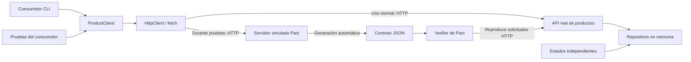

# Contract Testing con Pact

Proyecto académico de **Jefry Ariel Mas Monterroso**, Universidad Mariano Gálvez de Guatemala. Demuestra que un consumidor y una API de productos mantienen un acuerdo sobre sus solicitudes y respuestas HTTP. Incluye la generación automática del contrato, su verificación contra el proveedor real y una incompatibilidad reproducible.

Repositorio: [jefroMMM/Contract-Testing-con-Pact](https://github.com/jefroMMM/Contract-Testing-con-Pact).

## Qué hace la aplicación

El consumidor consulta un producto por su identificador. Si existe, muestra su nombre, precio en quetzales y disponibilidad. Si recibe un HTTP 404 con código `PRODUCT_NOT_FOUND`, comunica que el producto no existe. Los errores de red, respuestas inválidas, otros errores HTTP y los 404 de otras causas se propagan como errores; no se convierten en productos inexistentes.

La API implementa `GET /products/:id` con el servidor HTTP nativo de Node.js. El catálogo inicial contiene `p-100` y se almacena en memoria. No necesita base de datos, Docker, Pact Broker, cuentas ni servicios externos para funcionar o ejecutar las pruebas.

## Arquitectura



| Componente | Archivo | Responsabilidad |
| --- | --- | --- |
| Cliente HTTP reutilizable | `src/http-client.ts` | Ejecutar GET, interpretar JSON y conservar errores HTTP/red. |
| Consumidor de productos | `src/product-client.ts` | Validar el producto y distinguir `found` de `not-found`. |
| Consumidor ejecutable | `src/consumer-cli.ts` | Consultar la API y mostrar un mensaje. |
| API proveedora | `src/provider.ts`, `src/server.ts` | Atender solicitudes HTTP y serializar respuestas. |
| Repositorio | `src/product.ts` | Mantener datos deterministas en memoria. |
| Contrato del consumidor | `tests/consumer.pact.test.ts` | Ejecutar el cliente real contra el servidor simulado de Pact. |
| Verificador | `tests/verify-provider.ts` | Preparar estados y verificar el contrato contra la API real. |

## Herramientas y requisitos

| Herramienta | Versión fijada / requisito |
| --- | --- |
| Node.js | 22.23.2 usada para la entrega; se requiere Node.js 22 o superior. |
| npm | Incluido con Node.js; `package-lock.json` fija la instalación. |
| TypeScript | 5.9.3. |
| Pact JS | `@pact-foundation/pact` 17.1.4; requiere Node.js >=22. |
| tsx | 4.23.15 para ejecutar TypeScript. |
| Playwright | 1.64.1, solo para capturar el visor de evidencias. |
| Pruebas y HTTP | `node:test`, `node:assert/strict`, `node:http` y `fetch`. |

Se necesita Git para clonar el repositorio y acceso a Internet para descargar dependencias durante la instalación. Las pruebas usan puertos locales libres asignados automáticamente. Pact utiliza componentes nativos: se recomienda Windows x64, Linux x64 o macOS en una arquitectura soportada por Pact JS. `.nvmrc` indica la versión de Node utilizada.

## Instalación y configuración

Los siguientes comandos funcionan en PowerShell y en terminales de Linux/macOS:

```sh
git clone https://github.com/jefroMMM/Contract-Testing-con-Pact.git
cd Contract-Testing-con-Pact
node --version
npm ci
```

Si ya tienes esta carpeta descargada, abre la terminal en su raíz y comienza con `npm ci`. El proyecto no necesita archivo `.env` ni credenciales.

La API utiliza por defecto `http://127.0.0.1:3000`. Opcionalmente, `PORT` cambia su puerto y `API_URL` cambia la URL usada por el consumidor ejecutable. Ninguna variable es necesaria para las pruebas: estas crean sus propios servidores locales y los cierran al terminar.

## Ejecutar la aplicación real

En una terminal:

```sh
npm start
```

Con la API en ejecución, abre una segunda terminal en la misma carpeta:

```sh
npm run consumer -- p-100
npm run consumer -- p-404
```

La primera consulta muestra `Teclado mecanico: Q249.90 - disponible: true`; la segunda muestra `El producto p-404 no existe`. Detén la API con `Ctrl+C`.

## Interacciones del contrato

Ambas solicitudes incluyen `Accept: application/json` y las respuestas incluyen `Content-Type: application/json; charset=utf-8`.

| Aspecto | Producto existente | Producto inexistente |
| --- | --- | --- |
| Precondición | `existe el producto p-100`: catálogo reemplazado por el producto de ejemplo. | `no existe el producto p-404`: catálogo reemplazado por uno vacío. |
| Solicitud | `GET /products/p-100`. | `GET /products/p-404`. |
| Estado esperado | HTTP 200. | HTTP 404. |
| Respuesta esperada | `id`, `name`, `price` numérico y `available` booleano. | Objeto `error` con `code: PRODUCT_NOT_FOUND` y `message` de texto. |
| Interpretación del consumidor | `{ kind: 'found', product: ... }`. | `{ kind: 'not-found', message: ... }`. |

Ejemplo de respuesta exitosa:

```json
{"id":"p-100","name":"Teclado mecanico","price":249.9,"available":true}
```

Ejemplo de respuesta alternativa:

```json
{"error":{"code":"PRODUCT_NOT_FOUND","message":"El producto p-404 no existe"}}
```

Los estados HTTP, rutas, `id` y código de error se comparan por su valor exacto. Los matchers `string`, `decimal` y `boolean` permiten variaciones válidas de nombre, precio, disponibilidad y mensaje, conservando el tipo esperado. Las assertions también comprueban el resultado completo que interpreta el cliente a partir de los ejemplos del servidor simulado. Esto comprueba la compatibilidad de estas dos interacciones; no sustituye todas las pruebas de negocio, seguridad o rendimiento.

## Generar el contrato y probar al consumidor

```sh
npm run test:consumer
```

El script elimina únicamente el contrato anterior de este par consumidor/proveedor y ejecuta las dos pruebas. Cada prueba configura una interacción en Pact y llama a `ProductClient`, que utiliza el `HttpClient` real y `fetch` para comunicarse por HTTP con el servidor simulado. Pact comprueba la solicitud y las assertions comprueban la interpretación de la respuesta.

Al finalizar correctamente, Pact genera automáticamente:

```text
pacts/ProductConsumer-ProductProvider.json
```

Este archivo está incluido en la entrega. **No debe editarse manualmente**. Para cambiar las expectativas, modifica las pruebas del consumidor, vuelve a ejecutarlas y verifica después el proveedor.

## Verificar el proveedor real

```sh
npm run test:provider
```

Primero debe existir el contrato; si aún no lo has generado, ejecuta `npm run test:consumer`. El verificador inicia la API real en un puerto disponible, lee el contrato local, prepara los estados, reproduce las solicitudes y compara las respuestas. Cierra el servidor en un bloque `finally`, incluso si la verificación falla. No publica resultados en un Broker.

Los `stateHandlers` están definidos en `tests/verify-provider.ts`. Cada uno ejecuta `repository.reset(...)` y reemplaza todos los datos. Por ello, el estado de producto existente no depende de que antes se haya ejecutado el inexistente, ni viceversa. No existen endpoints administrativos abiertos para preparar los datos.

### Componentes reales y simulados

| Fase | Componentes reales | Componentes controlados o simulados |
| --- | --- | --- |
| Pruebas contractuales del consumidor | `ProductClient`, `HttpClient`, `fetch` y comunicación HTTP local. | API reemplazada por el servidor simulado de Pact. |
| Verificación del proveedor | Servidor HTTP, rutas, serialización y consulta al repositorio de la aplicación. | Contenido del repositorio en memoria preparado por cada estado. |
| Aplicación normal | Cliente, API y repositorio en memoria. | No hay servicios externos ni base de datos que simular. |

El repositorio en memoria es la implementación real de persistencia de esta aplicación pequeña; las pruebas controlan sus datos. No se afirma haber verificado una base de datos externa.

## Demostración obligatoria: compatible, incompatible y corregido

La demostración completa y sus registros se generan con:

```sh
npm run demo
```

La secuencia ejecuta las pruebas del consumidor y, a continuación, las tres verificaciones del proveedor: compatible inicial, incompatible y compatible restaurada. El fallo intermedio es esperado, pero debe proceder de una incompatibilidad real detectada por Pact; un error de instalación o de arranque no constituye evidencia válida de esa incompatibilidad.

Para reproducirla paso a paso:

```sh
npm run test:consumer
npm run test:provider
npm run test:provider:incompatible
npm run test:provider
```

La tercera orden **debe finalizar con código distinto de cero**: activa `incompatiblePrice` exclusivamente en el servidor de la verificación y serializa `price` como `"249.9"` en lugar de `249.9`. Pact compara esa respuesta con el matcher decimal del contrato y detecta la diferencia en `$.price`. No se modifica el contrato ni se fabrica un fallo con una assertion deliberadamente falsa.

La cuarta orden arranca una nueva instancia con la implementación compatible. No requiere editar archivos ni deshacer cambios: la opción incompatible dura únicamente durante el proceso que la solicita. `npm start` siempre crea el proveedor compatible. La versión final conserva el precio numérico.

## Pruebas completas

```sh
npm test
```

Ejecuta, en orden, la comprobación estricta de TypeScript, las cinco pruebas complementarias, las dos pruebas contractuales del consumidor, la verificación compatible del proveedor y una prueba de los ejecutables reales de API y consumidor CLI. También se pueden ejecutar individualmente:

```sh
npm run typecheck
npm run test:unit
npm run test:consumer
npm run test:provider
npm run test:smoke
```

`test:provider:incompatible` pertenece a la demostración y queda fuera de `npm test`, porque su resultado correcto es un fallo contractual.

## Evidencias auténticas

La carpeta `evidencias/` conserva las salidas originales de los procesos de la demostración y `resumen.json`, con los metadatos de ejecución:

| Etapa | Registro combinado | Captura | Salida esperada |
| --- | --- | --- | --- |
| Consumidor | `01-consumidor.log` | `01-consumidor.png` | 0: dos pruebas aprobadas. |
| Proveedor inicial | `02-proveedor-compatible.log` | `02-proveedor-compatible.png` | 0: contrato verificado. |
| Cambio incompatible | `03-proveedor-incompatible.log` | `03-proveedor-incompatible.png` | 1: Pact detecta el tipo incorrecto de `price`. |
| Proveedor restaurado | `04-proveedor-restaurado.log` | `04-proveedor-restaurado.png` | 0: contrato verificado nuevamente. |

Cada etapa conserva además sus archivos `.stdout.log` y `.stderr.log` originales por separado. El `.log` combinado contiene primero stdout y después stderr; no representa el orden temporal de intercalación entre ambos canales. `resumen.json` registra comando, fechas UTC de inicio y fin, código de salida, versión de Node y hashes SHA-256 del contrato y del registro. La demostración comprueba que el hash del contrato permanece idéntico durante las tres verificaciones.

Las imágenes son **capturas de un visor de los registros originales de ejecución**, no capturas de una terminal nativa. El visor identifica el comando y resultado real; no vuelve a ejecutar Pact ni inventa resultados. Los archivos de texto permiten revisar la salida completa, incluido el detalle del fallo que una captura puede mostrar solo parcialmente.

Para renovar los registros y capturas:

```sh
npm run demo
npx playwright install chromium
npm run evidence:capture
```

`scripts/capture-evidence.mjs` utiliza Playwright para abrir el visor y capturarlo en Chromium; requiere que la demostración haya generado antes los registros. El comando `npx playwright install chromium` descarga ese navegador una vez. En Windows, si ya tienes Microsoft Edge instalado, puedes utilizarlo sin descargar Chromium:

```sh
npm run evidence:capture -- --edge
```

Conserva juntos logs, resumen e imágenes de una misma ejecución para no mezclar resultados.

Los archivos `05-pruebas-finales.log` y `06-demostracion-completa.log` conservan también la validación final y la demostración completa. `.gitattributes` preserva los bytes de contratos y registros para que Git no altere sus hashes al cambiar de sistema operativo. Pact puede emitir el aviso de dependencia `DEP0060`; los códigos de salida y los resultados contractuales determinan si la ejecución pasó.

## Informe y diagrama

- Informe académico: [PDF](output/pdf/informe-contract-testing.pdf).
- Fuente editable del informe: [Markdown](docs/informe.md).
- Arquitectura: diagrama Mermaid de este README y diagrama del informe.

El PDF se genera directamente con herramientas de documentación y queda listo para cargarlo en **Canvas**, la plataforma educativa de la universidad. La carga en Canvas corresponde al responsable de la entrega; no se afirma que el documento haya sido creado o entregado dentro de esa plataforma.

Para regenerar el informe localmente, utiliza Python 3.10 o superior (3.13.14 usado en la entrega):

```sh
python -m pip install -r requirements-report.txt
npm run report
```

Genera primero las evidencias. `scripts/build-report.py` produce el PDF y su fuente Markdown; ReportLab 4.5.1 y pypdf 6.21.2 están fijados en `requirements-report.txt`. La instalación de Node.js y npm es suficiente para ejecutar la aplicación y sus pruebas; Python solo interviene al reconstruir el PDF.

## Identificación de la entrega

Versión de entrega: `entrega-v1.0.0`. La etiqueta permite identificar el conjunto completo de código, contrato, evidencias y documentación:

```sh
git fetch --tags
git show entrega-v1.0.0 --stat
git rev-parse entrega-v1.0.0^{commit}
```

En PowerShell, si tu terminal interpreta las llaves, utiliza `git rev-parse 'entrega-v1.0.0^{commit}'`. La referencia remota de la entrega es [entrega-v1.0.0](https://github.com/jefroMMM/Contract-Testing-con-Pact/tree/entrega-v1.0.0).

## Referencias

- [Pact JS: documentación y requisitos](https://docs.pact.io/implementation_guides/javascript/readme).
- [Pact JS: pruebas del consumidor](https://docs.pact.io/implementation_guides/javascript/docs/consumer).
- [Pact JS: verificación del proveedor y estados](https://docs.pact.io/implementation_guides/javascript/docs/provider).
- [Pact: estados del proveedor](https://docs.pact.io/getting_started/provider_states).
- [Pact JS 17.1.4 en npm](https://www.npmjs.com/package/@pact-foundation/pact/v/17.1.4).
