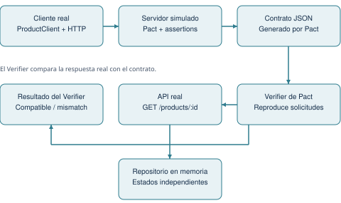
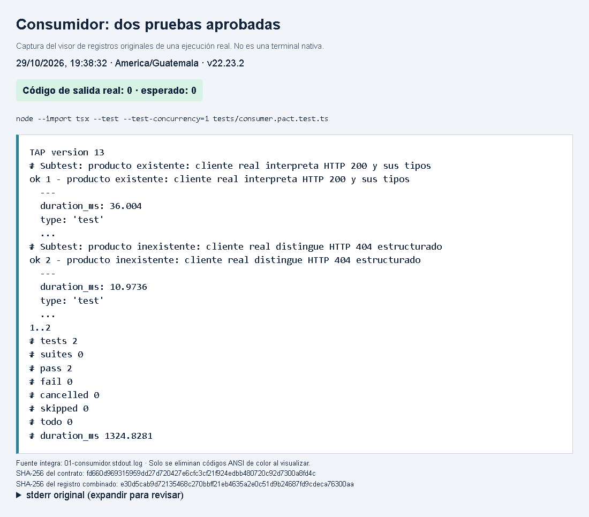
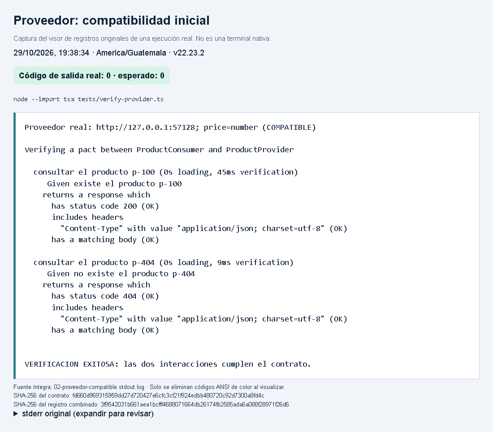
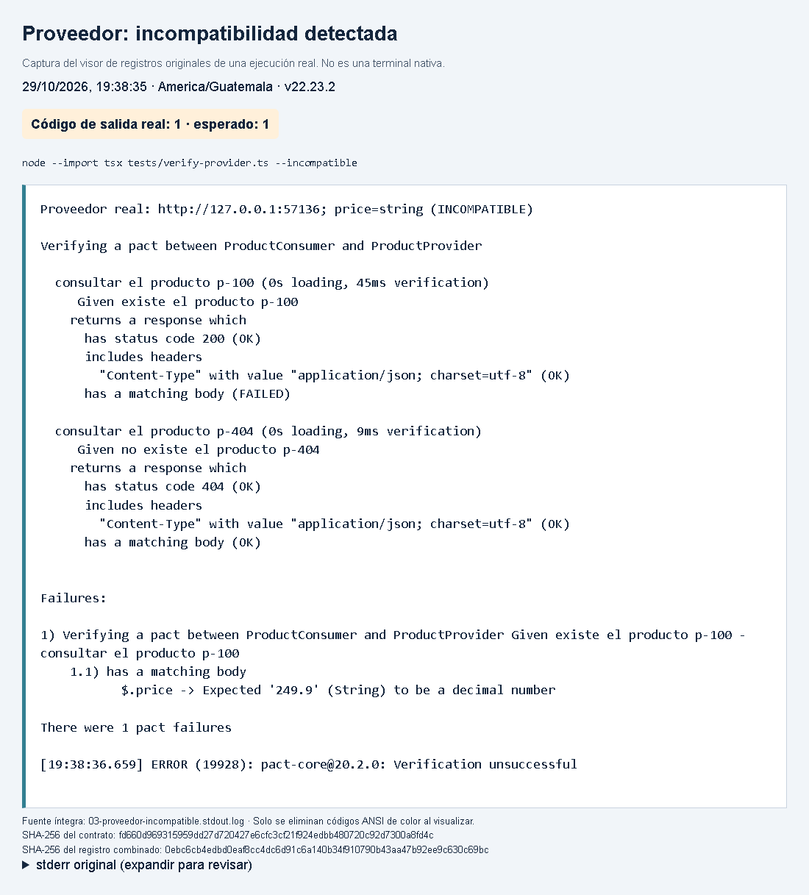
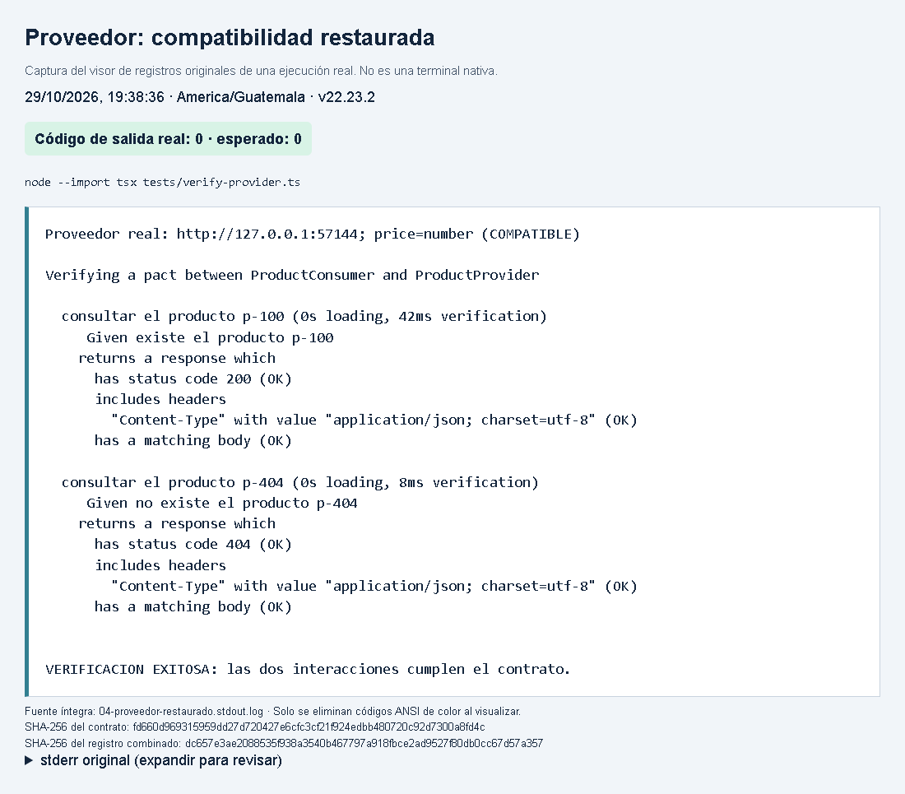

# Compatibilidad entre consumidor y proveedor utilizando Pact

Universidad Mariano Gálvez de Guatemala


Responsable: Jefry Ariel Mas Monterroso

Caso de estudio: consulta de productos mediante una API HTTP en TypeScript.

Fecha de ejecución: 29/10/2026 · America/Guatemala.

Versión de entrega: entrega-v1.0.0


## 1. Introducción y contexto del caso

Cuando dos aplicaciones se comunican, una respuesta HTTP exitosa no garantiza que ambas interpreten los datos de la misma manera. Un campo puede conservar su nombre y cambiar de tipo, provocando un error en el consumidor. Las pruebas de contrato permiten expresar las expectativas del consumidor y comprobarlas contra el proveedor.

El objetivo de este proyecto es comprobar de forma reproducible la compatibilidad de un consumidor de productos con su API proveedora. Se implementaron ambas partes en TypeScript y se utilizó Pact JS para generar y verificar un contrato local, sin depender de un Broker ni de servicios pagados.

Precondición: existe p-100 en el catálogo. Solicitud: GET /products/p-100 con Accept: application/json. Respuesta: HTTP 200 y un producto con id p-100, name de texto, price decimal y available booleano. El consumidor devuelve kind: found y valida los tipos antes de utilizar los datos. Esta interacción representa el flujo principal de consulta.

Precondición: el catálogo no contiene p-404. Solicitud: GET /products/p-404. Respuesta: HTTP 404 con error.code igual a PRODUCT_NOT_FOUND y error.message de texto. El consumidor devuelve kind: not-found. Se eligió este caso porque una ausencia esperada debe distinguirse de un fallo del servidor o de una ruta equivocada.

Las dos respuestas utilizan Content-Type: application/json; charset=utf-8. Las rutas, estados HTTP, identificador y código de error son valores exactos; los campos variables se comprueban con matchers de tipo. La muestra exitosa es un teclado con precio Q249.90 y disponibilidad verdadera.


## 2. Arquitectura y herramientas



ProductClient interpreta los resultados y utiliza HttpClient, un cliente HTTP reutilizable basado en fetch. La API usa node:http y consulta ProductRepository. Durante las pruebas del consumidor, Pact sustituye a la API; durante la verificación, el verificador envía solicitudes a la API real y compara las respuestas con el archivo JSON generado previamente.

Versiones: Node 22.23.2; npm 10.9.8; TypeScript 5.9.3; tsx 4.23.15; Pact JS 17.1.4; Playwright 1.64.1; Python 3.13.14; ReportLab 4.5.1; pypdf 6.21.2.


## 3. Diseño y ejecución de las pruebas

tests/consumer.pact.test.ts configura PactV3 y sus dos interacciones. executeTest inicia el servidor simulado y ejecuta el ProductClient y HttpClient reales contra su URL. Las assertions comparan los resultados completos. Pact verifica las solicitudes y escribe pacts/ProductConsumer-ProductProvider.json; este JSON no se redacta manualmente.

string conserva el tipo de name y del mensaje; decimal exige un número decimal para price; boolean valida available. El id y PRODUCT_NOT_FOUND se fijan por igualdad para evitar que otro producto u otra clase de error sean aceptados como correctos.

tests/verify-provider.ts inicia la misma API usada por la aplicación. Los stateHandlers reemplazan por completo el catálogo: [sampleProduct] para existencia y [] para ausencia. Cada ejecución dispone de un repositorio propio y un puerto libre. Una prueba adicional comprueba las consultas en ambos órdenes y el servidor se cierra incluso si la verificación falla.

Son reales el consumidor, fetch, la comunicación HTTP, la API, las rutas y la serialización. En las pruebas del consumidor la API se simula con Pact. En el proveedor se controlan los datos del repositorio en memoria, que es la persistencia real de esta aplicación; no se simula una base de datos externa.

Las cinco pruebas complementarias comprueban HTTP 500, un 404 de otra causa, un precio de tipo incorrecto, un producto con otro ID y la independencia de estados. Estas pruebas complementan las dos interacciones contractuales.

```sh
npm ci
npm test
npm run demo
npm run evidence:capture -- --edge
npm run report
```

Alternativa sin Edge: `npx playwright install chromium` y `npm run evidence:capture`. Dependencias del informe: `python -m pip install -r requirements-report.txt`.


## 4. Evidencia: consumidor

Se ejecutaron las dos pruebas con el cliente HTTP real contra el servidor simulado de Pact. Se esperaba interpretar correctamente el producto y el error estructurado. El resultado fue 2 pruebas aprobadas, 0 fallidas y salida 0; Pact generó automáticamente el contrato.



Comando: `node --import tsx --test --test-concurrency=1 tests/consumer.pact.test.ts`. Código de salida: 0. Registro: `evidencias/01-consumidor.log`.


## 5. Evidencia: proveedor compatible

Se verificó el contrato generado contra la API real con sus estados independientes. Se esperaba cumplir ambos acuerdos. Pact confirmó los estados 200 y 404, los encabezados y los cuerpos de respuesta. La ejecución terminó con salida 0.



Comando: `node --import tsx tests/verify-provider.ts`. Código de salida: 0. Registro: `evidencias/02-proveedor-compatible.log`.


## 6. Evidencia: incompatibilidad real

Se activó --incompatible: el proveedor serializó price como texto. Se esperaba que Pact rechazara ese tipo. La interacción p-100 falló en $.price: esperaba decimal y recibió String. La interacción 404 siguió aprobada. El proceso devolvió 1 y el contrato no cambió.



Comando: `node --import tsx tests/verify-provider.ts --incompatible`. Código de salida: 1. Registro: `evidencias/03-proveedor-incompatible.log`.


## 7. Evidencia: compatibilidad restaurada

Se inició otra instancia sin la mutación, con price numérico. Se esperaba recuperar la compatibilidad. Pact aprobó nuevamente las dos interacciones y devolvió 0. La versión normal y la entrega final conservan el proveedor compatible.



Comando: `node --import tsx tests/verify-provider.ts`. Código de salida: 0. Registro: `evidencias/04-proveedor-restaurado.log`.


## 8. Reproducción, conclusiones y referencias

npm run demo ejecuta las cuatro etapas y acepta únicamente las salidas 0, 0, 1 y 0. La etapa incompatible exige un BodyMismatch en $.price; no basta un fallo cualquiera. El cambio solo existe en la instancia de demostración. npm run test:provider restaura la compatibilidad al crear un proveedor sin esa opción, y npm test ejecuta la validación final completa.

resumen.json conserva fechas UTC, comandos, salidas y hashes SHA-256. Las capturas muestran la hora local de Guatemala. Los canales stdout y stderr se preservan por separado; el log combinado concatena ambos y no afirma su orden de intercalación. El visor elimina solo códigos de color ANSI para facilitar la lectura. El mismo contrato se utilizó en las cuatro etapas.

SHA-256 del contrato: `fd660d969315959dd27d720427e6cfc3cf21f924edbb480720c92d7300a8fd4c`.

La verificación mostró que el consumidor y el proveedor son compatibles en los dos escenarios definidos. El fallo controlado demostró que conservar HTTP 200 no es suficiente: cambiar el tipo de un campo requerido rompe el acuerdo. Los estados independientes permitieron repetir las pruebas y recuperar el resultado correcto sin editar el contrato. Pact complementa las pruebas de comportamiento, pero este alcance no incluye carga, seguridad ni otros casos de negocio.

La entrega incluye código, contrato generado, cuatro capturas, registros originales y README reproducible. El informe está listo para cargar manualmente en Canvas.

Repositorio: https://github.com/jefroMMM/Contract-Testing-con-Pact

Etiqueta final: https://github.com/jefroMMM/Contract-Testing-con-Pact/tree/entrega-v1.0.0

- [Pact JS: pruebas del consumidor](https://docs.pact.io/implementation_guides/javascript/docs/consumer)
- [Pact JS: verificación del proveedor](https://docs.pact.io/implementation_guides/javascript/docs/provider)
- [Pact: estados del proveedor](https://docs.pact.io/getting_started/provider_states)
- [Pact JS 17.1.4: requisitos del paquete](https://www.npmjs.com/package/@pact-foundation/pact/v/17.1.4)
